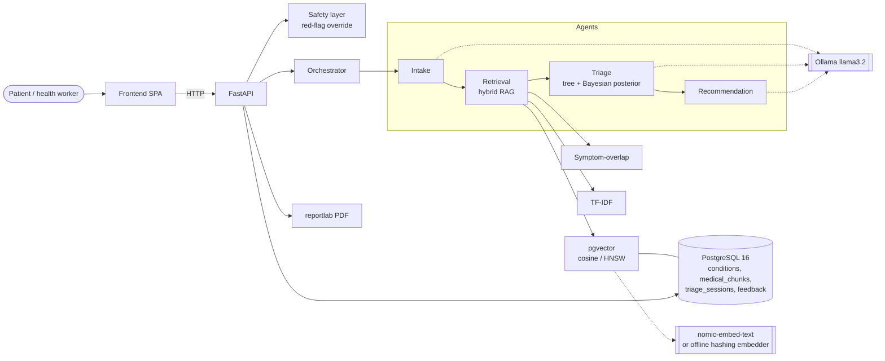
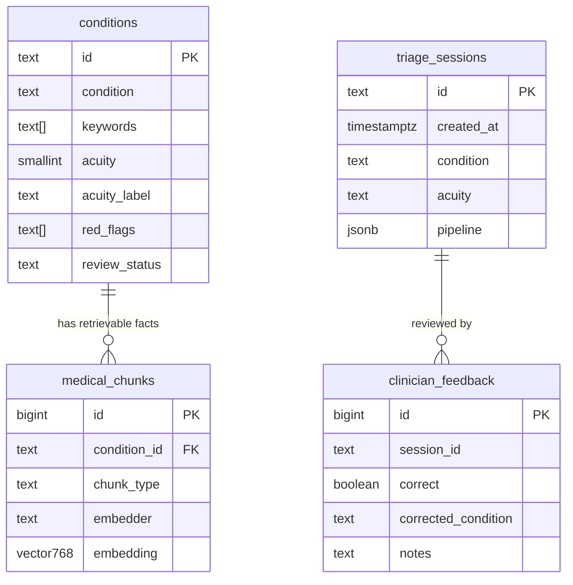
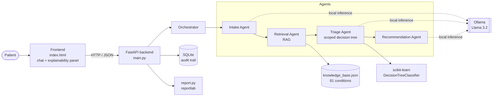
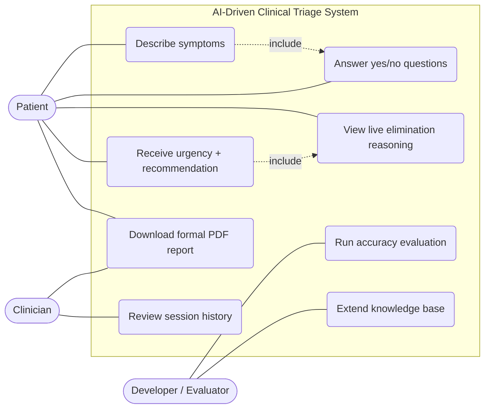
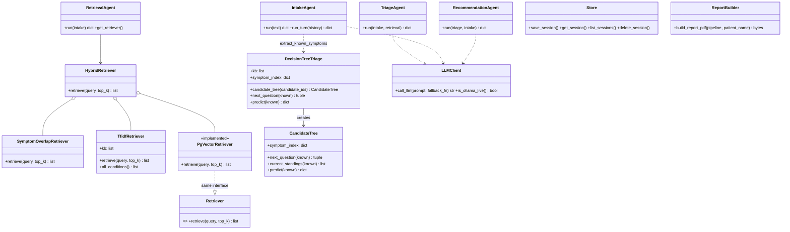
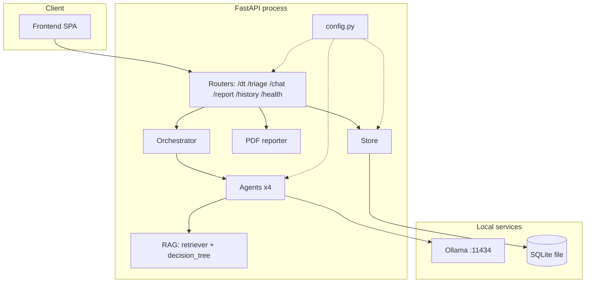
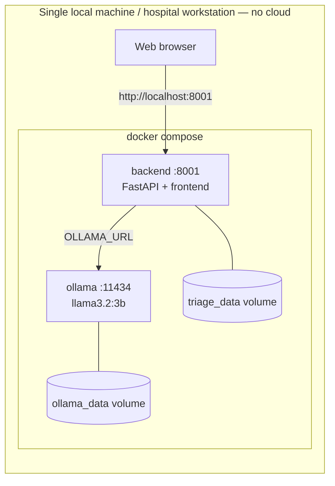
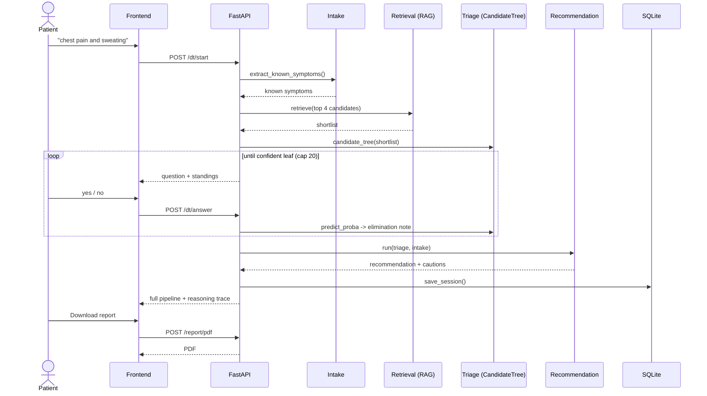

# Architecture & UML

All diagrams are [Mermaid](https://mermaid.js.org) (render on GitHub / VS Code / mermaid.live; export PNG/SVG for slides).

## 0. Full-scale stack

### Database ERD (PostgreSQL + pgvector)

### Retrieval fusion
Symptom-overlap (IDF-weighted cosine; abstains with <2 symptoms) + TF-IDF + pgvector are merged with reciprocal-rank
fusion (k=20). A failing signal never breaks retrieval. The ranking becomes the **prior** for Triage's Bayesian
posterior; final probabilities = 0.3 × decision-tree `predict_proba` + 0.7 × posterior.

### Safety invariants
1. Red flags in the patient's own words force EMERGENCY (never downgrade).
2. Urgency is raised to that of any plausible, more-urgent alternative (worst-case aware).
3. Confidence gate (≥ 0.85) and ≥ 3 real questions before concluding (when informative questions exist).

---

## 1. System architecture

Key invariant: **Retrieval runs first and hands its shortlist to Triage.** Triage's tree is
trained only on that shortlist, so the stages can never reach contradicting conclusions.

## 2. Use case diagram

## 3. Class diagram

## 4. Component diagram

## 5. Deployment diagram

## 6. Sequence diagram — yes/no triage session

